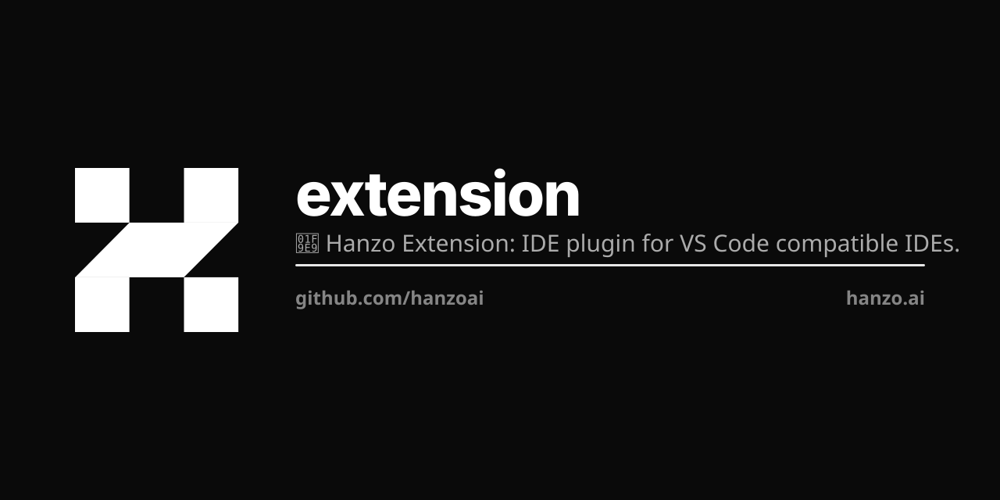

<p align="center"></p>

# Hanzo extensions

Hanzo AI inside every browser, editor and work app. One pnpm workspace; every
build lands in `dist/`.

```bash
make install
make build                  # everything
make build target=chrome    # one target
make test
make check                  # the CI gate: build, test, bundle budget, e2e
```

## Browser

| Target | Source | Load |
|---|---|---|
| Chrome, Edge, Brave | `packages/browser` | `chrome://extensions` → Developer mode → Load unpacked → `dist/chrome` |
| Firefox | `packages/browser` | `about:debugging#/runtime/this-firefox` → Load Temporary Add-on → `dist/firefox/manifest.json` |
| Safari | `packages/browser` | `dist/safari-xcode` (built on macOS with Xcode) |

## Everything else

| Kind | Packages |
|---|---|
| Editors, notebooks | `vscode`, `jetbrains` (Gradle), `jupyter` |
| Desktop | `desktop`, `dxt` (Claude Desktop) |
| Documents, email | `office` (Word, Excel, PowerPoint), `outlook`, `gworkspace` (Docs, Sheets, Slides, Gmail), `notion`, `pdf` |
| Design | `figma`, `sketch`, `canva` |
| Chat, meetings | `slack`, `teams`, `meetings` (Zoom, Meet) |
| Code hosts | `github`, `gitlab` |
| Business apps | `salesforce`, `hubspot`, `zendesk`, `shopify`, `quickbooks`, `workday`, `docusign`, `clio`, `imanage`, `procore`, `epic`, `canvas-lms` |
| Shared libraries | `auth`, `cards`, `aci`, `mcp` |
| Download site | `apps/site` |

Each lives at `packages/<name>` with its own README; its build is linked at
`dist/<name>`.

## Release

Bump `packages/browser/package.json` (patch only) and merge to `main`. The
publish workflow ships a version npm does not have yet to the Chrome Web Store,
Firefox Add-ons and npm.
